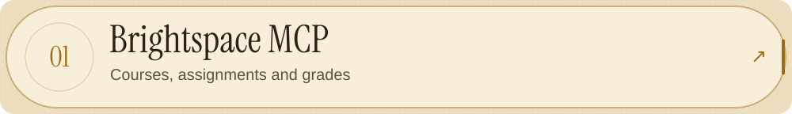
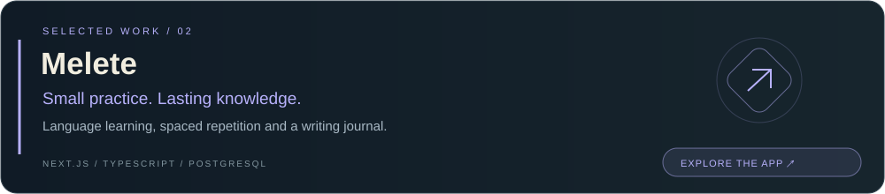
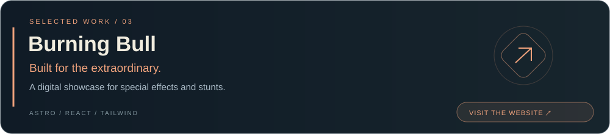
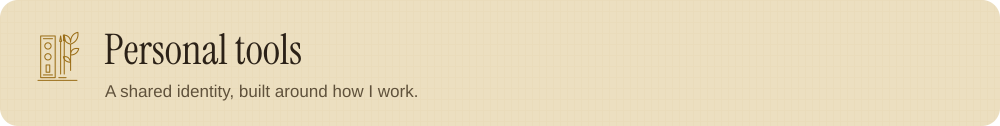
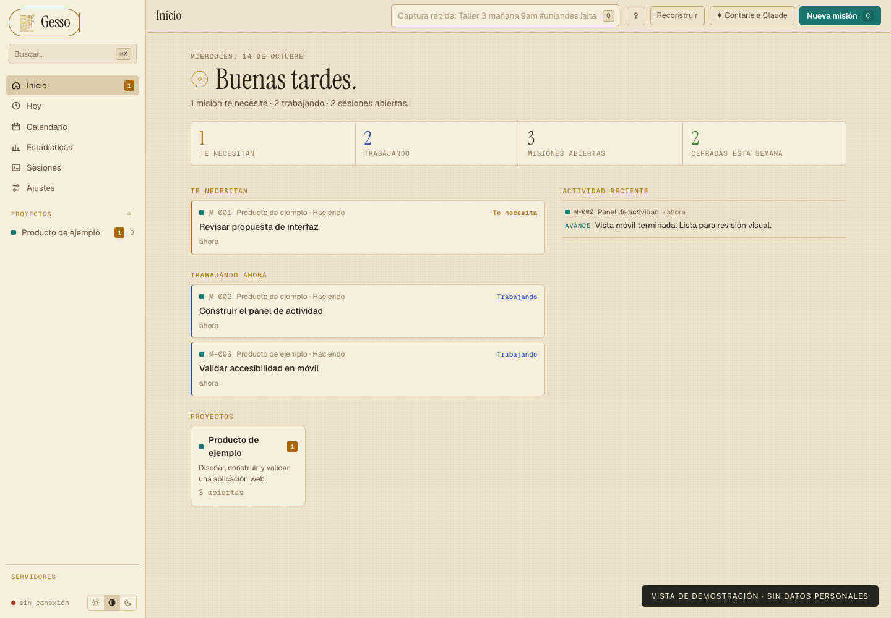
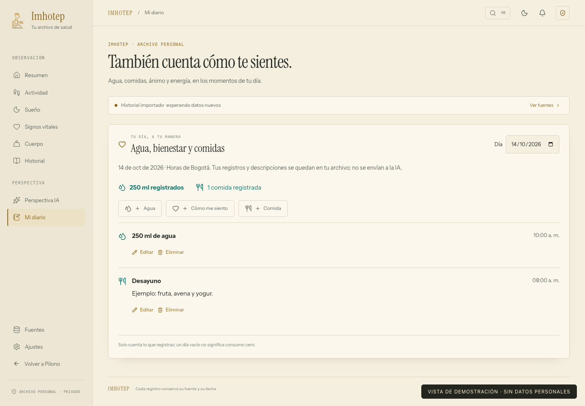
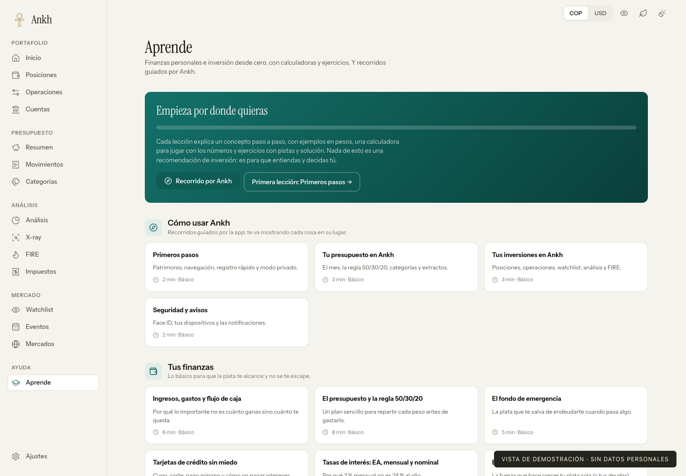
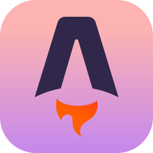
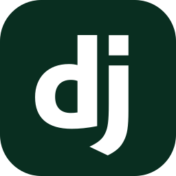

  <picture><source media="(max-width: 600px) and (prefers-color-scheme: dark)" srcset="assets/hero-mobile-dark.svg" /><source media="(max-width: 600px)" srcset="assets/hero-mobile.svg" /><source media="(prefers-color-scheme: dark)" srcset="assets/hero-dark.svg" /></picture>

  
  &nbsp;
  

  I build web applications and integrations in TypeScript and Python. 
  Here are some of the projects I work on.

---

### Projects

 

<a href="https://github.com/JhostinAleck/brightspace-mcp"><picture><source media="(max-width: 600px) and (prefers-color-scheme: dark)" srcset="assets/brightspace-mobile-dark.svg" /><source media="(max-width: 600px)" srcset="assets/brightspace-mobile.svg" /><source media="(prefers-color-scheme: dark)" srcset="assets/brightspace-dark.svg" /></picture></a>

Courses, grades, assignments and content for MCP-compatible assistants. Multiple authentication strategies, MFA, caching and explicit controls for write operations.

 

 

<a href="https://melete-langs.vercel.app/"><picture><source media="(max-width: 600px) and (prefers-color-scheme: dark)" srcset="assets/melete-mobile-dark.svg" /><source media="(max-width: 600px)" srcset="assets/melete-mobile.svg" /><source media="(prefers-color-scheme: dark)" srcset="assets/melete-dark.svg" /></picture></a>

Spaced repetition, vocabulary practice and a writing journal, with optional AI-assisted feedback. The app is public; the source code is private.

 

<a href="https://burningbull.com.co/"><picture><source media="(max-width: 600px) and (prefers-color-scheme: dark)" srcset="assets/burning-bull-mobile-dark.svg" /><source media="(max-width: 600px)" srcset="assets/burning-bull-mobile.svg" /><source media="(prefers-color-scheme: dark)" srcset="assets/burning-bull-dark.svg" /></picture></a>

A responsive, visual website for a special-effects and stunts company. 

 

<picture><source media="(prefers-color-scheme: dark)" srcset="assets/collection-dark.svg" /></picture>

<table>
<tr>
<td width="33%" valign="top">
<h3>Gesso</h3>
<b>A workspace for coding agents.</b>

Missions, progress, activity and review requests for Claude Code and Codex.

<code>Next.js</code> <code>PostgreSQL</code> PRIVATE CODE · DEMO DATA

</td>
<td width="33%" valign="top">
<h3>Imhotep</h3>
<b>A personal health archive.</b>

Health records, synchronization, daily habits and insights grounded in your data.

<code>React</code> <code>Python</code> <code>PWA</code> PRIVATE CODE · DEMO DATA

</td>
<td width="33%" valign="top">
<h3>Ankh</h3>
<b>Finance, made understandable.</b>

Portfolio analysis, budgets, contribution simulations and financial education.

<code>React</code> <code>FastAPI</code> PRIVATE CODE · EDUCATIONAL VIEW

</td>
</tr>
</table>

Click any preview to explore it at full size. Screenshots contain no personal health records, financial balances or private project details.

### Tools I use

&nbsp;
&nbsp;
&nbsp;
&nbsp;
&nbsp;
&nbsp;
&nbsp;
&nbsp;
&nbsp;

<b>↳ A little more about how I build</b>

- **Interfaces:** React, Next.js and Astro, with attention to mobile layouts and clear interactions.
- **Systems:** Python, Django, FastAPI and PostgreSQL; APIs and integrations that connect the pieces.
- **Operations:** Docker, self-hosted services and everyday automation.
- **Beyond web:** GIS and spatial analysis with ArcGIS and QGIS.

---

  <b>Get in touch</b>  
  

Profile artwork based on Pilono · Instrument Serif · Technology icons by <a href="https://github.com/tandpfun/skill-icons">Skill Icons</a> (MIT).
