<!-- Continuous tablet: keep images top-aligned and adjacent. See docs/profile-layout.md. -->

<picture><source media="(max-width: 600px)" srcset="assets/tablet/01-header-mobile.svg" /></picture><picture><source media="(max-width: 600px)" srcset="assets/tablet/02-projects-mobile.svg" /></picture><a href="https://github.com/JhostinAleck/brightspace-mcp"><picture><source media="(max-width: 600px)" srcset="assets/tablet/03-brightspace-mobile.svg" /></picture></a><a href="https://jhostinaleck.github.io/brightspace-mcp/"><picture><source media="(max-width: 600px)" srcset="assets/tablet/04-docs-mobile.svg" /></picture></a><a href="https://melete-langs.vercel.app/"><picture><source media="(max-width: 600px)" srcset="assets/tablet/05-melete-mobile.svg" /></picture></a><a href="https://burningbull.com.co/"><picture><source media="(max-width: 600px)" srcset="assets/tablet/06-burning-mobile.svg" /></picture></a><picture><source media="(max-width: 600px)" srcset="assets/tablet/07-private-mobile.svg" /></picture><a href="assets/gesso.png"><picture><source media="(max-width: 600px)" srcset="assets/tablet/08-gesso-mobile.svg" /></picture></a><a href="assets/imhotep.png"><picture><source media="(max-width: 600px)" srcset="assets/tablet/08-imhotep-mobile.svg" /></picture></a><a href="assets/ankh.png"><picture><source media="(max-width: 600px)" srcset="assets/tablet/08-ankh-mobile.svg" /></picture></a><picture><source media="(max-width: 600px)" srcset="assets/tablet/09-note-mobile.svg" /></picture><picture><source media="(max-width: 600px)" srcset="assets/tablet/10-stack-title-mobile.svg" /></picture><picture><source media="(max-width: 600px)" srcset="assets/tablet/11-stack-mobile-v2.svg" /></picture><picture><source media="(max-width: 600px)" srcset="assets/tablet/12-contact-mobile.svg" /></picture><a href="https://www.linkedin.com/in/jhostin-aleck-sanchez-603454177/"><picture><source media="(max-width: 600px)" srcset="assets/tablet/13-linkedin-mobile.svg" /></picture></a><a href="mailto:jhostinaleck@jadevia.com"><picture><source media="(max-width: 600px)" srcset="assets/tablet/14-email-mobile.svg" /></picture></a><picture><source media="(max-width: 600px)" srcset="assets/tablet/15-footer-mobile.svg" /></picture>

Text version, links & credits

## Jhostin Aleck

Systems Engineer from Universidad de los Andes, Colombia. I build web applications and integrations in TypeScript and Python.

### Projects

- **[Brightspace MCP](https://github.com/JhostinAleck/brightspace-mcp)** — An open-source integration connecting MCP-compatible assistants to D2L Brightspace courses, assignments, grades and content. Multiple authentication strategies, MFA, caching and explicit write controls. [Documentation](https://jhostinaleck.github.io/brightspace-mcp/).
- **[Melete](https://melete-langs.vercel.app/)** — Language learning through spaced repetition, vocabulary practice and a writing journal with optional AI-assisted feedback. Public app; private source code.
- **[Burning Bull](https://burningbull.com.co/)** — A responsive website for a special-effects and stunts company.

### Personal tools — private source code

- **Gesso** — A workspace for coding agents: missions, progress, agent activity and review requests. Next.js and PostgreSQL. [Demo screenshot](assets/gesso.png).
- **Imhotep** — A health archive with records, daily habits and synchronization monitoring. React, Python and PWA. [Demo screenshot](assets/imhotep.png).
- **Ankh** — Portfolio analysis, budgets, contribution simulations and financial education. React and FastAPI. [Educational-content screenshot](assets/ankh.png).

Screenshots contain demonstration data or educational content, without personal health records, financial balances or private project details.

### Tools

TypeScript, React, Next.js, Astro, Python, Django, FastAPI, Java, Spring Boot, PostgreSQL, Docker and Git. My background also includes GIS and spatial analysis with ArcGIS and QGIS.

[LinkedIn](https://www.linkedin.com/in/jhostin-aleck-sanchez-603454177/) · [Email](mailto:jhostinaleck@jadevia.com)

Artwork inspired by Pilono. Instrument Serif lettering. Technology icons by [Skill Icons](https://github.com/tandpfun/skill-icons), under the [MIT license](assets/tech/LICENSE).

